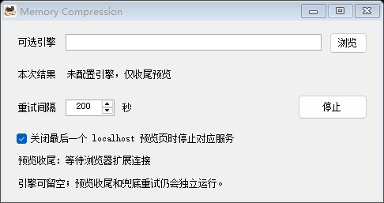

<p align="center">
  
</p>

# Memory Compression

**为 Vibe Coding 准备的定时内存清理器。设好间隔，让清理在后台按时执行。**

A scheduled memory-cleanup companion for Vibe Coding, with optional localhost preview cleanup.

[**下载 Windows 便携版**](https://github.com/M47E1/memory-compression/releases/latest) · [开始使用](#直接使用) · [开机启动](#开机启动) · [预览收尾范围](#会关闭什么) · [审计说明](AUDIT.md)

Windows 10/11 · 可设置时间 · 后台执行 · 可选浏览器扩展 · MIT

## 长时间 Vibe Coding，把清理交给定时器

编辑器、浏览器、终端和开发服务常常一开就是一天。把可信的内存释放引擎接入工具，设置执行间隔，就能定时在后台调用，无需每次手动点清理。默认间隔 200 秒，可自行调整；上一轮引擎尚未结束时，不重复启动。

内存清理、定时执行和本地预览收尾分开处理。浏览器扩展只负责额外的 localhost 预览收尾：最后一页关掉后，等待约 3 秒，再核对并停止对应服务；刷新或仍有同端口页面时，服务继续运行。

```text
选择可信引擎 → 设置执行间隔 → 后台定时调用
可选：连接浏览器扩展 → 关闭最后一个预览页 → 核对并停止对应服务
```

**清理引擎由你选择。** 开源包不下载或捆绑鲁大师等第三方程序。配置引擎后才能执行内存释放；具体清理范围和效果由所选引擎决定。引擎留空时仅启用预览收尾，不会自行清空系统缓存或删除分页文件。引擎失败也不影响预览收尾。

> **名称说明：** Memory Compression 为项目名称，并非 Windows 系统内存压缩功能的开关，也不包含自行实现的内存压缩算法。它负责定时调用清理引擎与预览进程收尾，不承诺提高系统速度或释放固定容量的内存。

## 直接使用

需要 Windows 10/11 和 .NET Framework 4.8 或更新的 4.x 运行环境。普通使用不需要 Node.js、Python、Visual Studio 或管理员权限。目标服务必须属于当前用户可停止的进程；权限不足时不会自动提权。

1. **解压并运行。** 从上方下载便携 ZIP，解压后双击 `MemoryCompression.exe`。
2. **配置清理与时间。** 通过“浏览”选择自己信任、有权使用的内存释放引擎，再设置间隔。当前界面中的“重试间隔”同时用于引擎执行间隔与预览兜底重试；点击“停止”可暂停，两项功能会一起暂停。
3. **按需连接预览收尾。** 如果还希望关掉预览页面时停止对应服务，再在 Chrome 的 `chrome://extensions` 或 Edge 的 `edge://extensions` 中开启开发者模式，加载包内的 `browser-extension` 文件夹。扩展名称为 **Memory Compression**，固定 ID 为 `dgpfiadablpfojbalengndogkiidplcb`；弹窗显示“已连接”后再使用。进程核对和退出还需要少量时间，不保证在整整 3 秒时退出。

最小化后继续计时；**关闭主窗口会退出程序**，当前没有关窗后托盘保活。后台执行指清理引擎在隐藏桌面运行，并非安装 Windows 系统服务。

### 程序界面



封面为 ImageGen 制作的项目插画；上图为实际程序界面。截图中的引擎栏留空，因此只启用预览收尾。

Chrome、Edge、不同浏览器配置文件需要分别加载。同一端口在任一已连接浏览器中仍打开时，不停止。无痕窗口需要在这个扩展的详细设置里允许无痕/InPrivate 使用；未允许时，不要在普通窗口与未受监看的无痕窗口同时查看同一个服务。

发布程序未做商业代码签名。下载来源、Windows SmartScreen、企业软件策略可能影响运行；本项目不会关闭或绕过这些保护。组织策略拒绝时请联系管理员。

## 会关闭什么

仅识别直接由 Node 启动的 Next.js（`dev` / `start`）、Vite（`dev` / `serve` / `preview`）、Astro（`dev` / `preview`）特定入口。Next.js、Vite 无参数的默认开发模式也支持。工具根据真实监听端口登记 PID、创建时间、程序路径和父进程，停止前重新检查，不按 `node.exe` 名字批量结束进程。只处理在这个扩展中被观察、识别过的服务，不猜测哪些旧服务是“残留”。

识别只看实际入口脚本，不看参数里是否“提到”框架名；`build`、内联脚本、通用 `cmd.exe` 启动器都不管理。常见 Node 调试、预加载和内存参数可以识别；遇到不认识的 Node 参数，或只传框架选项却省略子命令时，会保留服务而不是猜测。后一种情况可改为显式 `next dev`、`vite dev` 等启动方式。某些通用启动器可能继续存在，本工具不会为清掉它们而扩大进程终止范围。

**停止使用的是进程终止，不是应用层优雅退出。** 不要用它管理生产服务器、后台任务或必须常驻的 localhost 应用。希望页面关闭后继续运行时，先取消“关闭最后一个 localhost 预览页时停止对应服务”的勾选；“停止”按钮会同时暂停预览收尾与可选引擎。

刷新、切换标签、最小化、冻结/休眠标签不算关闭。普通 Node API、MCP 和不认识的服务不处理。浏览器强退或扩展失联也不推定为关页；恢复连接并收到新报告后再确认。没有安装扩展的其他浏览器、其他设备和用户无法被观察，因此不要把这些未连接的客户端用于同一服务的生命周期保护。

首次停止失败时，默认每 200 秒再尝试；这项重试与外部内存引擎无关。权限拒绝、进程身份变化或操作记录不完整时，不放宽检查强行停止。

## 可选：自己的内存释放引擎

默认留空。只选择自己信任、有权使用的外部 EXE。窗口中的“浏览”可以选择引擎；程序不会扫描电脑寻找引擎，不会下载、捆绑、提权或自动安装第三方程序。

需要参数时，在 EXE 所在目录运行：

```powershell
.\MemoryCompression.exe --optimizer "D:\Tools\TrustedOptimizer.exe" --optimizer-arguments "/optimize" --interval 200
```

`/optimize` 只是参数格式示例，具体参数由所选引擎决定，默认不传参数。设置仅对本次启动生效。引擎缺失、无法启动、返回失败或执行时间较长，都不暂停预览收尾。相同引擎尚未退出时，不重复启动。

引擎在单独的隐藏 Windows 桌面上执行，避免动效打扰；不兼容这种方式的引擎会失败，但不会影响预览收尾。界面中的“可用内存增加”是执行前后系统可用内存的差值，受其他程序影响，不能证明引擎实际释放了同等内存，也不是分页文件清理量。

## 开机启动

可以使用 Windows 的启动文件夹，在当前用户登录后自动运行。**当前没有内置开机启动开关，也不会自动写入启动项。** 这是 Windows 提供的快捷方式机制，参见 [Microsoft 的启动应用说明](https://support.microsoft.com/zh-cn/windows/experience/startup-boot/configure-startup-applications-in-windows)。

1. 把程序放在固定目录，按 `Win + R`，输入 `shell:startup`，打开当前用户的启动文件夹。
2. 在该文件夹中新建快捷方式，目标填写自己的程序路径。需要每次自动使用同一引擎、间隔与最小化状态时，将参数一并写进目标，例如：

```text
"D:\Tools\MemoryCompression\MemoryCompression.exe" --optimizer "D:\Tools\TrustedOptimizer.exe" --interval 200 --start-minimized
```

3. 保存快捷方式。下次登录 Windows 时会按该配置启动；取消时移除自己创建的快捷方式即可。需要引擎参数时再加 `--optimizer-arguments`，参数由所选引擎决定。

界面设置仅对本次运行生效，快捷方式中的参数才是下次启动时的配置。程序仍以当前用户权限运行，不自动提权。

## 隐私、记录和并存

扩展只获得 localhost、127.0.0.1、::1 的 HTTP(S) 主机权限及 `storage` / `alarms` 权限，没有浏览全部网站的 `tabs` 权限，也没有内容脚本。发送内容只有随机浏览器标识、递增编号、时间和本地端口，不包含网页标题、路径或非本地地址。请求只发往本机 `127.0.0.1:47832`。

运行记录保存在当前用户的 `%LOCALAPPDATA%\MemoryCompression\preview-events`。记录包含本地进程路径等诊断信息，**不要把自己的记录目录或浏览器配置文件上传到公开仓库**。记录为版本 1 的追加式事件，包含编号、UTC 时间、运行与浏览器身份；观察、判断、请求停止、结果分开记录。重启时只读旧记录，不修改原始内容，未收到浏览器新报告前不重放停止操作。

开源版有自己的 EXE 名称、扩展 ID、端口、单实例标识和数据目录，不替换旧版工具或旧扩展。验证时可以并存；实际使用建议只给同一个项目启用一套生命周期管理工具，避免两套工具各自作出停止判断。

## 从源码编译

源码包不包含编译结果、第三方引擎、浏览器、个人路径、旧备份或本机运行记录。

```powershell
.\Build.ps1
.\bin\MemoryCompression.exe
```

使用 Windows .NET Framework 自带的 C# 编译器，不需要 .NET SDK 或 NuGet 下载。脚本不会更改系统执行策略。若脚本被组织策略禁止，请使用获准的开发环境，不要为了运行它关闭保护。

## 开发验证

对抗式审计结果与已知限制见 [AUDIT.md](AUDIT.md)。

需要 Node.js 18+。基础验证不启动浏览器，也不需要安装 npm 依赖：

```powershell
.\Test.ps1
```

包含扩展端口规则、控制器生命周期、追加事件重放、50 个命令行误识别反例与正常用例、真实 WinForms 定时运行、无引擎/无效引擎/失败引擎/运行中引擎的独立性，以及离屏界面渲染。可选引擎测试使用测试代码编译出的微型助手，不执行用户安装的清理引擎。

浏览器验证另外安装固定版本的开发依赖和 Chromium：

```powershell
npm ci --ignore-scripts
npx playwright install chromium
.\Test.ps1 -Browser
```

浏览器测试使用一个全新隔离配置和真正的无引擎 GUI 程序，不触碰日常浏览器配置。Windows 窗口放在屏幕外，并检查位置；结束后关闭测试自身启动的进程。资源不足、端口占用或缺少浏览器时会停止验证，不结束其他进程来腾位置。默认通过微型 Node 服务验证识别与退出流程，不把它们冒充成实际框架兼容性验证。

可用已有 Playwright/Chromium，避免重新下载：

```powershell
.\Test.ps1 -Browser -PlaywrightPath "D:\Dev\node_modules\playwright" -ChromiumPath "D:\Browsers\chromium\chrome.exe"
```

已有一个安装依赖并构建完成的 Next.js 项目时，可额外验证真实 Next.js 进程。会在另一个临时端口启动一份实例，关闭测试页后核对对应 PID 退出、端口释放，不关闭原来的实例：

```powershell
.\Test.ps1 -Browser -RealNextProject "D:\Dev\built-next-app"
```

本地结果保留在 `test-output`，不进入源码包或便携包。程序设置和界面为中文；未声称在所有 Windows 版本、所有浏览器配置和所有框架版本上验证过。

## 打包与许可证

```powershell
.\Package.ps1
```

`artifacts` 下生成源码 ZIP 和 Windows 便携 ZIP。打包按明确的文件名单复制，不会把开发目录、测试结果、依赖缓存或个人备份整个压进去。已存在的包不会覆盖，重新打包可传 `-OutputDirectory` 指定新目录。

本项目采用 [MIT License](LICENSE)（[OSI 原文](https://opensource.org/license/mit)）。MIT 许可仅覆盖本项目代码，不授予任何第三方内存清理引擎的使用或分发权利。参见 [NOTICE](NOTICE)。
